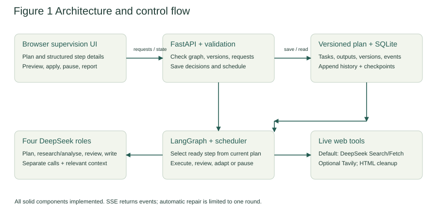
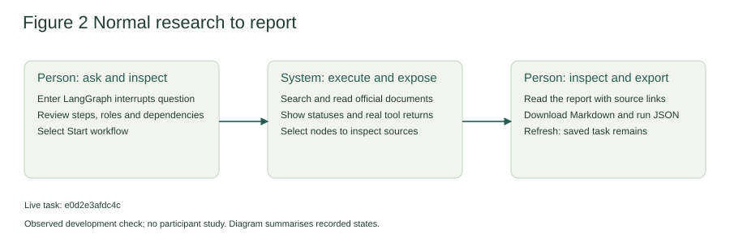
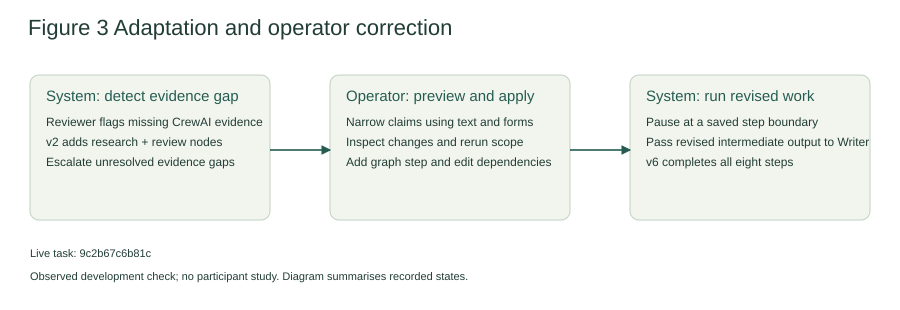

# Human Oversight of Adaptive Multi-Agent LLM Workflows

Workflow Observatory | A2 Project Report | Student ID 3095715

Total report word count: 1054 | Abstract: 183 | Main report, including headings: 871.

## Abstract

Workflow Observatory is a local prototype for supervising adaptive multi-agent research workflows. A person can see the proposed execution plan, inspect each step and its tool evidence, and change the work that will actually run. The project addresses a difficulty beyond tracing conversations: understanding the consequences of a workflow revision before relying on its output. Its current scope is web research followed by a cited report. Separate planning, research, review and writing calls use DeepSeek; an application scheduler executes a versioned task graph through LangGraph. The English browser interface combines a workflow graph with structured details, change explanations, preview and application of edits, result revision, pause/resume and downloads. SQLite preserves versions, events and earlier results. Three real development cases covered normal execution, evidence-driven adaptation with operator correction, and recovery from a search-provider rate limit. Fourteen automated tests separately checked execution and intervention constraints with injected services. These checks demonstrate a functioning supervision loop, rather than an improvement in human comprehension or decision quality. The prototype prioritises inspectable actions and bounded recovery; participant evaluation, broader task support and full historical playback remain future work.

## Problem and scope

Adaptive research assistants can change the route from a question to an answer. A new check may improve coverage, but a plausible explanation can also hide missing evidence. The interaction problem is therefore to make changes inspectable and consequential controls accessible. AGDebugger supports debugging and steering agent conversations [1]; Cocoa supports shared editable plans and replanning [2]. These precedents make editing a foundation rather than a novelty claim. The project develops a working setting for examining change-specific evidence and downstream effects. Its first version handles sequential web research, not arbitrary autonomous tasks.

## Design rationale

The workflow graph externalises dependencies, while the selected step shows objective, status, inputs, output and tool calls. Recognition rather than recall motivates retaining state in the interface to reduce memory demands. Consequently, users select visible steps instead of remembering conversation positions or constructing inspection commands. Detailed tool parameters remain expandable, limiting competition with the execution overview. This is a design rationale, not a measured reduction in cognitive load. The event log is secondary because a chronological sequence alone does not reveal which later results depend on a changed step.

Changes use one highlighted graph plus an added/removed/updated list, justification, evidence and rerun scope. Feedback must be noticeable and interpretable; observability helps bridge the gulf of evaluation and supports agency. The interface therefore labels statuses in text as well as colour, announces automatic adjustments, and distinguishes pending drafts from applied versions. Automatic evidence repair continues without asking for approval at every revision. Human edits require a preview, and applying during an active call is prevented until the workflow reaches a saved boundary. This balances continuity with deliberate control.

Text instructions are convenient for expressing intent, but the resulting interpretation is uncertain. Forms expose exact objectives, activities and dependencies; graph controls add or remove steps and connections. All three routes use the same validator and preview/apply operation. This implements efficient correction from the human-AI interaction guidelines [3]. Prompting involves specification followed by checking: a model-generated edit is consequently a draft, not an instruction automatically trusted by the executor. Completed intermediate outputs can also be revised, with their origins labelled and previous results retained.

## Architecture and intelligence

Figure 1 separates the React/TypeScript interface, FastAPI boundary, versioned plan and storage, LangGraph execution, role models and web tools. A Planner produces a validated directed acyclic graph. Researcher calls generate queries, execute search and webpage retrieval, and analyse returned evidence; Reviewer assesses support; Writer composes the report. These are distinct calls with relevant upstream context, not independent model installations. LangGraph executes steps with SQLite checkpoints [4]; the application scheduler repeatedly selects a ready node from the current plan. SQLite snapshots govern recovery at step boundaries, while SSE delivers recorded events after reconnection.

DeepSeek supplies the role model and the default Search/Fetch APIs [5]. Tavily remains optional. Application code is responsible for validation and execution. Pydantic checks plan fields; additional checks reject duplicate IDs, cycles, missing dependencies and disconnected work. Version checks prevent stale previews overwriting newer plans, and repeated applications are idempotent. Changing a step invalidates its descendants, hides the previous report and preserves earlier outputs. Traceable evidence connects claims to inspectable sources: reports use source IDs mapped to retrieved URLs, although this identity check cannot establish that every claim is entailed by its source.

Intelligent interaction combines sensing, uncertain interpretation, action and a closed human loop. Here, returned webpages and review outcomes supply signals beyond the original command; the model infers whether coverage is adequate, changes the plan and exposes that action to correction. The inference can be wrong, as the comparison case showed. Context assembly is also an application responsibility. Each role receives relevant upstream outputs and source identifiers rather than recursively nested conversation logs. This preserves inspectability while bounding unnecessary context. Default limits allow three search operations, five requested pages, one service retry and one automatic repair per task. Exhausting these limits produces an actionable pause rather than unlimited execution. An interrupted external request may run again after restart, so recovery is explicitly described at step boundaries.

## Developed interaction

Figures 2-3 illustrate observed development interactions. In the normal case, a LangGraph-interrupts question produced a previewed plan, retrieved official documentation and a report. Selecting steps exposed actual tool records; browser download and refresh were checked. In the comparison case, initial searches overrepresented LangGraph. Reviewer detected missing CrewAI evidence, so the system added research and review nodes and showed their impact. Remaining gaps caused escalation. The operator narrowed the report through text and form previews, later added an analysis node using graph editing, and revised its intermediate result. The eight-step version completed after affected writing reran.

## Development evidence and limits

The linked development record distinguishes student-specified requirements, Codex-assisted implementation and operator checks. Fourteen automated tests use injected services to exercise graph validation, automatic repair, stale and repeated edits, revisions, affected reruns, failure recovery, restart state and pause races. They are separate from the three live cases. Source code, setup commands, dependency locks and selected evidence support inspection. No participants were recruited. A future evaluation should compare equivalent tasks and control opportunities, measuring change comprehension, affected-step prediction and justified intervention separately from preference. Full playback, broader inputs and semantic claim verification remain unfinished; the current evidence supports functional feasibility only.

## Repository and revision

Repository: https://github.com/Llanuras/iis-workflow-observatory

README: https://github.com/Llanuras/iis-workflow-observatory/blob/a2-final-2026-11-25/README.md

Submitted release: a2-final-2026-11-25

Development record: https://github.com/Llanuras/iis-workflow-observatory/blob/a2-final-2026-11-25/docs/DEVELOPMENT.md

## References

[1] Epperson, W. et al. (2025). Interactive Debugging and Steering of Multi-Agent AI Systems. CHI 2025. https://doi.org/10.1145/3706598.3713581

[2] Feng, K. J. K. et al. (2026). Cocoa: Co-Planning and Co-Execution with AI Agents. CHI 2026. https://doi.org/10.1145/3772318.3791673

[3] Amershi, S. et al. (2019). Guidelines for Human-AI Interaction. CHI 2019. https://doi.org/10.1145/3290605.3300233

[4] LangChain (2026). Graph API overview and persistence. https://docs.langchain.com/oss/python/langgraph/graph-api ; https://docs.langchain.com/oss/python/langgraph/persistence

[5] DeepSeek (2026). Your First API Call; Search & Fetch. https://api-docs.deepseek.com/ ; https://api-docs.deepseek.com/guides/search/

## System diagram and interaction examples

System architecture and control flow. All solid components are implemented.

Normal execution: plan preview, source inspection and export.

Automatic evidence repair and operator correction, ending at workflow v6.
